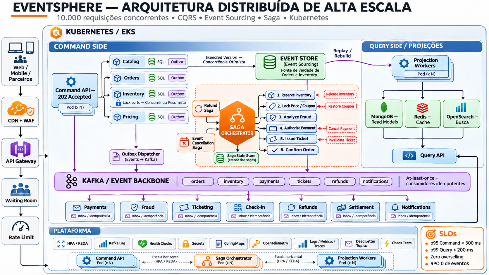

# EventSphere

EventSphere evolui o projeto original de venda de ingressos para uma plataforma distribuída de operação de eventos. A implementação nova convive com os serviços legados durante a migração e cobre reserva de estoque, pagamento, antifraude, emissão, settlement, notificação, reembolso, cancelamento de evento, transferência e check-in.



## Arquitetura implementada

- DDD e Clean Architecture em `Domain`, `Application`, `Infrastructure` e `Api`.
- Event Sourcing append-only para `Order`, `Inventory` e `Ticket`.
- CQRS com Command API, Query API, projections, checkpoint e rebuild.
- Saga persistente para compra, com retries, leases e compensações.
- Workflows duráveis de reembolso, cancelamento massivo e transferência.
- Transactional Outbox, Inbox e idempotência HTTP.
- Concorrência otimista por `expectedVersion`.
- Kafka como backbone de integração e buffer durável de comandos, separado do Event Store.
- Deploys independentes para command, order-consumer, query, saga, projection, integration e outbox.
- Kubernetes com probes, HPA, PDB, NetworkPolicy, migration/replay jobs e KEDA opcional.

## Projetos

```text
src/EventSphere.Domain          agregados, eventos e value objects
src/EventSphere.Application     casos de uso, portas, Saga e projections
src/EventSphere.Infrastructure  EF Core, SQL Event Store, Kafka, Outbox/Inbox e workers
src/EventSphere.Api             Command API, Query API e endpoints operacionais
tests/EventSphere.UnitTests     domínio, concorrência, Saga, replay e arquitetura
gateway-api                     gateway Go legado, idempotente por external_id
tickets-api                     API legada mantida somente para migração
```

## Execução local sem dependências

A ausência de connection strings ativa stores EF InMemory e um publisher local:

```bash
dotnet restore EventSphere.sln
dotnet run --project src/EventSphere.Api/EventSphere.Api.csproj --urls http://localhost:8080
```

## Stack distribuída

```bash
export EVENTSPHERE_DB_PASSWORD='use-a-local-secret'
export EVENTSPHERE_API_KEY='use-a-local-api-key'
export EVENTSPHERE_ADMIN_API_KEY='use-a-different-admin-key'
export EVENTSPHERE_JWT_SIGNING_KEY='use-at-least-32-random-characters'
docker compose -f infra/eventsphere/docker-compose.yml up --build \
  --scale command-api=3 --scale order-consumer=4 --scale saga-worker=4 \
  --scale lifecycle-worker=1 --scale expiry-worker=1 --scale outbox-worker=1 \
  --scale integration-worker=1 --scale projection-worker=1
```

O perfil local limita SQL Server a 1,5 CPU/3 GiB (com 2.304 MiB de limite interno para preservar overhead), Redpanda a 1,5 CPU/2,5 GiB, APIs a 0,35 CPU/320 MiB e workers a 0,25 CPU/320 MiB. O perfil de auditoria com mais réplicas deve ser usado apenas durante o benchmark.
Como a fila do laboratório limitado demora mais para drenar, o Compose usa TTL de reserva de 30 minutos (`EVENTSPHERE_RESERVATION_TTL_MINUTES`); o Kubernetes mantém o padrão operacional de 5 minutos.

- Command API: `http://localhost:8080`
- Query API: `http://localhost:8081`
- `Idempotency-Key` é obrigatório em `POST /api/v2/orders`.
- Endpoints públicos de comando e dados pessoais exigem JWT (`sub` GUID e papéis `customer`, `organizer`, `gate` ou `admin`); a API key administrativa é exclusiva de `/internal`.
- Ownership é aplicado em pedidos, tickets, transferências e reembolsos; organizadores recebem escopo por claim `show_id`.
- O preço é carregado do evento imutável `InventoryCreated`, sem confiar no cliente ou em dual-write de catálogo.
- Com `Commands__AsyncIngress=true`, a resposta `202` confirma persistência no Kafka; o consumer cria Event Store e Saga com IDs determinísticos.

## Testes

```bash
dotnet test tests/EventSphere.UnitTests/EventSphere.UnitTests.csproj -c Release
dotnet test tests/TicketsApi.UnitTests/TicketsApi.UnitTests.csproj -c Release
(cd gateway-api && GOCACHE=/tmp/eventsphere-go-cache go test ./...)
kubectl kustomize infra/k8s/base >/dev/null
```

Flash sale completa — 10.000 VUs e 50.000 tentativas:

```bash
mkdir -p artifacts
export JWT_TOKEN="$(JWT_SIGNING_KEY="$EVENTSPHERE_JWT_SIGNING_KEY" ROLE=admin \
  bash infra/stress-test/eventsphere/create-token.sh)"
BASE_URL=http://localhost:8080 \
JWT_TOKEN="$JWT_TOKEN" \
VUS=10000 ITERATIONS=50000 DURATION=10s CAPACITY=5000 \
k6 run infra/stress-test/eventsphere/flash-sale.js

BASE_URL=http://localhost:8080 \
ADMIN_API_KEY="$EVENTSPHERE_ADMIN_API_KEY" \
RUN_ID=seu-run-id SHOW_ID=seu-show-id \
bash infra/stress-test/eventsphere/verify.sh
```

Em produção, o teste de escala deve rodar contra Kubernetes com múltiplas réplicas. Para este laboratório com CPU, RAM e armazenamento limitados, a prova end-to-end usa Docker Compose com réplicas e limites explícitos; os manifests Kubernetes são validados separadamente por renderização com Kustomize. Um único processo mede o limite do processo, não o SLO da arquitetura escalada.

## Kubernetes

O secret não é versionado:

```bash
kubectl create namespace eventsphere --dry-run=client -o yaml | kubectl apply -f -
kubectl -n eventsphere create secret generic eventsphere-secrets \
  --from-literal=ConnectionStrings__WriteDb="$EVENTSPHERE_WRITE_DB" \
  --from-literal=ConnectionStrings__ReadDb="$EVENTSPHERE_READ_DB" \
  --from-literal=DbPassword="$EVENTSPHERE_DB_PASSWORD" \
  --from-literal=Security__ApiKey="$EVENTSPHERE_API_KEY" \
  --from-literal=Security__AdminApiKey="$EVENTSPHERE_ADMIN_API_KEY" \
  --from-literal=Security__JwtSigningKey="$EVENTSPHERE_JWT_SIGNING_KEY" \
  --from-literal=Stress__JwtToken="$JWT_TOKEN"
kubectl apply -k infra/k8s/base
```

Para o canário Strangler, `EVENTSPHERE_DEPLOY_LEGACY=true bash infra/cluster/start.sh`
renderiza o overlay que mantém os serviços antigos por rota. O procedimento de backfill
idempotente, validação de capacidade e rollback está em [Migração legada](./docs/legacy-migration.md).

KEDA e replay:

```bash
kubectl apply -f infra/k8s/keda-workers.yaml
kubectl create -f infra/k8s/replay-job.yaml
```

## Operação

- Mensagens carregam `MessageId`, `CorrelationId` e `CausationId`.
- Consumers são `at-least-once`; a Inbox garante idempotência.
- Falha permanente da compra inicia compensação reversa.
- Projeções podem ser reconstruídas a partir do Event Store.
- [Runbooks](./docs/runbooks.md), [ADRs](./docs/architecture-decisions.md), [catálogo de eventos](./docs/event-catalog.md), [migração legada](./docs/legacy-migration.md) e [relatório de validação](./docs/validation-report.md).
